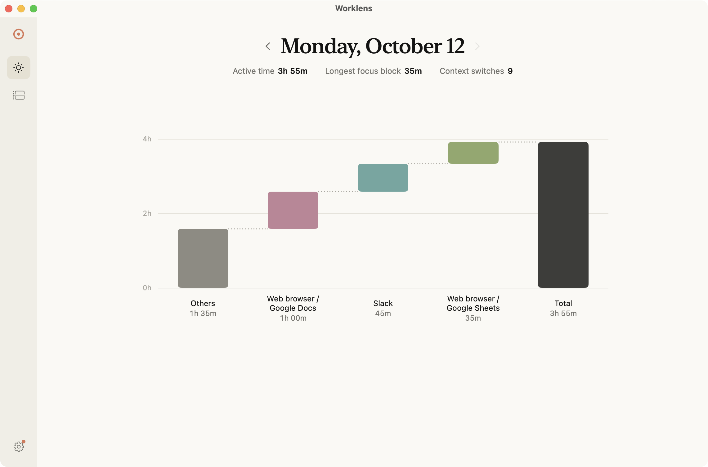
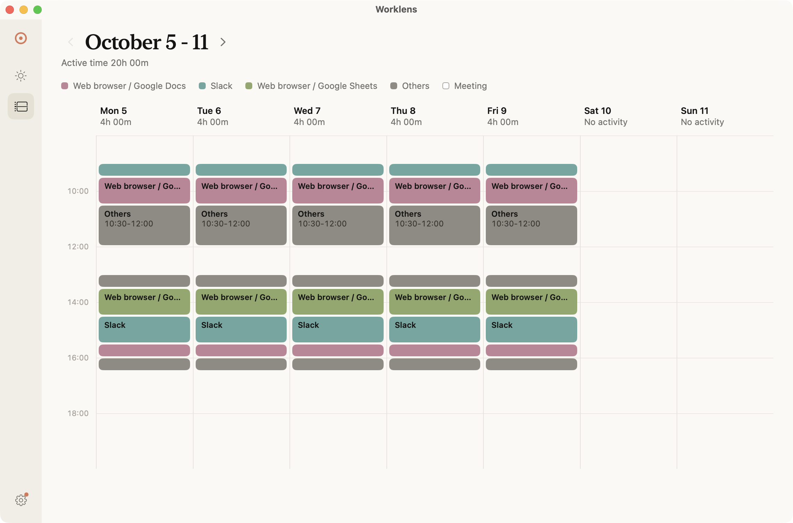
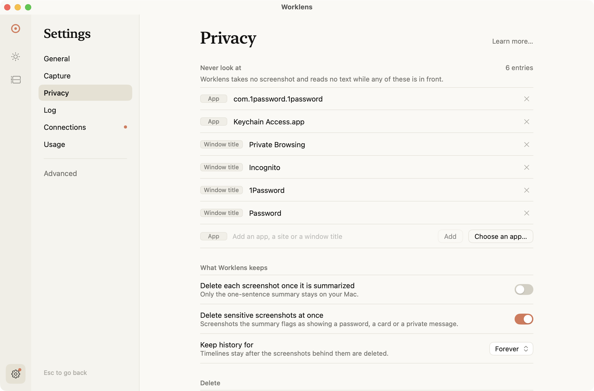
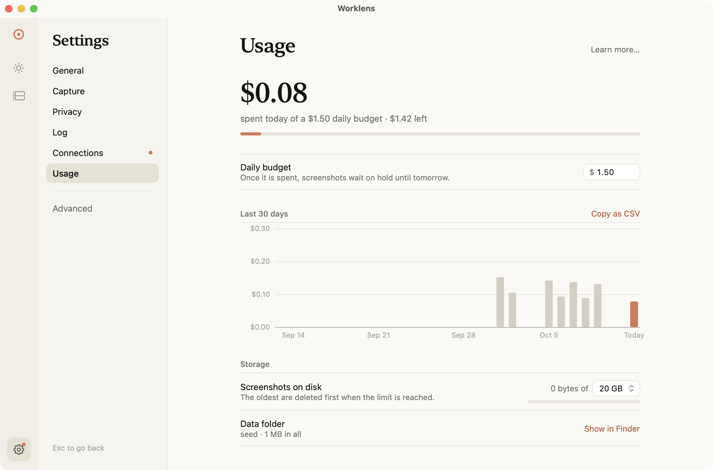

# Worklens

[](LICENSE)


**A menu-bar app that watches your own screen and lays out, as a timeline you can read, where
your day actually went.**

<p align="center">
  
</p>

<sub>The Today page, on a copy filled with the invented sample day in
`Tests/WorklensCoreTests/SampleDay.swift`. Sample data, not a real day.</sub>

Everything lives in one folder on your Mac — no server, no account, nothing for anyone else to
log into. It is a personal optimization tool, not a surveillance tool: you hold the pause hotkey,
the blocklists and the delete button, and everything it writes addresses you in the second
person, with no scores, rankings or comparisons.

## What you get

- **A timeline of every day**, drawn on the Today and Weeks pages and returned as plain Markdown
  by the `timeline` tool over MCP.
- **A menu one line long**, with pause, capture now and delete under it.
- **Your own day, answerable in Claude Desktop**, over a read-only MCP server in the same binary.

<p align="center">
  
</p>

<sub>The Weeks page, on the same sample copy: the invented day, five times over.</sub>

## What leaves your Mac

Everything else stays in one folder on your machine. This is every host any code in this
repository can reach — [PRIVACY.md](PRIVACY.md#what-leaves-your-machine) has the same table with
what is sent, when, how to turn each one off, and the file that implements it.

| Destination | What is sent | When |
|---|---|---|
| Google (Gemini) | the focused window's redacted text, a JPEG only when that text was incomplete, and the app, title, URL and timestamp around it | once per frame worth describing |
| GitHub | `git ls-remote origin refs/heads/main`, nothing about you — and only when the app runs from the checkout it was built from | when you press **Check now**, or every `AUTO_UPDATE_POLL_MINUTES` (15) once you turn auto-update on; it is off by default |
| Granola, Google Calendar | a token of yours and a request for your own recent items | only for the context sources you connect |

No analytics, no crash reporting, no identifier, and nothing that reaches the author of this
software. A test fails the build if a new host appears in `Sources/` without a row in PRIVACY.md.

## Install

macOS 14+, a Swift 6.1+ toolchain (`xcode-select --install` is enough), five minutes. There is
no prebuilt download: with no Apple Developer ID behind it one would be self-signed, so Gatekeeper
would refuse the first launch until you click **Open Anyway** in System Settings → Privacy &
Security, and because macOS ties Screen Recording, Accessibility and Automation to the signature,
every update would ask for all three again. Building from source signs with a certificate that
stays put across rebuilds:

```bash
/bin/bash -c "$(curl -fsSL https://raw.githubusercontent.com/Matheus-F-Scatolin/worklens/main/scripts/bootstrap.sh)"
```

It names every step, asks once, then downloads the source to
`~/Library/Application Support/Worklens/src`, builds, signs and installs it with a `worklens`
command on your `PATH`, and opens it on its welcome window. The build is one progress line; if it
stops, you get the last errors, the log's path and what to try. Safe to re-run. Leave that
folder where it is, or the app can no longer update itself.

### Install with Claude Code

Paste this into [Claude Code](https://claude.com/claude-code):

```text
Set up Worklens on this Mac: https://github.com/Matheus-F-Scatolin/worklens
Follow the "If someone asks you to install Worklens" section of its CLAUDE.md.
```

It shows you the plan and waits for your yes, then runs the same line. It never asks for your
Gemini key, and the macOS dialogs and permissions stay yours to answer.

For a checkout of your own:

```bash
git clone https://github.com/Matheus-F-Scatolin/worklens.git
cd worklens
make setup
```

`make setup` is the same sequence, asking before each step:
[docs/user/setup.md](docs/user/setup.md).

## First run

Worklens opens on a welcome window, and captures nothing until you finish it. Two of its pages
are yours to answer:

1. **Screen Recording.** Allow it when macOS asks, then press **Relaunch Worklens**: macOS only
   hands the answer to a copy that starts afterwards. The other two permissions it may ask for
   are in [docs/user/permissions.md](docs/user/permissions.md).
2. **Your Gemini key.** Get one at <https://aistudio.google.com/apikey> and paste it in; saving
   it asks Google whether it works (one free request, $0). No key yet? The window's tour opens
   Worklens over a sample week of invented days, so you can look around first.

   > **Use a billing-enabled Gemini project.** On Google's free tier your prompts and images may
   > be used to improve their models. On a paid project they are not.

Press **Done**, and the day's timeline fills in as you work. Closed the window early? **Finish
setting up Worklens** in the menu brings it back. The key can be changed later in Settings →
Connections. [docs/user/first-day.md](docs/user/first-day.md) walks through minute 0, minute 1,
the first hour and tomorrow, including every state the menu can be in.

## Cost

About **$0.10 a day — roughly $2 a month** at the defaults (an 8-hour day, a 60-second interval),
paid to Google directly for your own key. `DAILY_BUDGET_USD` (default `1.50`) is a
hard stop, not a warning: past it frames are captured but not described until you raise it.
The breakdown, and the three ways to make it cheaper, are in
[docs/user/cost.md](docs/user/cost.md).

It costs the Mac as little: **22 MB of dirty memory** idle and **~6 MB written per hour** at the
keyboard — one run on one Mac, method in [docs/footprint.md](docs/footprint.md). Unplugged it eases
off by itself: `CAPTURE_ON_BATTERY` ships as `slow`, so the menu reads *"On battery · capturing
every 5 min"*.

**How big it gets: about 12 MB of screenshots and 1.5 MB of database a day** — roughly 4 GB and
0.5 GB in a year — measured over eleven days on one Mac at about 190 screenshots a day.
`SCREENSHOT_DISK_BUDGET_GB` caps the first half and `RETENTION_DAYS` the second; the method, and
how to read your own numbers, are in [docs/user/data.md](docs/user/data.md#how-big-it-gets-and-how-to-make-it-age-out).

## Privacy controls

[`PRIVACY.md`](PRIVACY.md) is the full account: what is recorded, what never is, where it lives,
what leaves the machine, and how to delete any of it. The destinations are in the table
[under the hero](#what-leaves-your-mac); the controls are these:

- **`⌥⇧P` pauses everything from any app**, and pausing says so three ways: a line in the menu,
  a banner where notifications are allowed, and a VoiceOver announcement. The menu carries the
  key on a hint row of its own. It pauses until you resume; the "Pause" submenu has the timed
  options. Rebind it in Settings → General, by mouse or keyboard; the letter shown is whatever
  your own layout prints on that key. The pause is remembered: quitting, crashing or an
  auto-update brings Worklens back *still paused*, and it reminds you every
  `PAUSE_REMINDER_HOURS` (default 4) that it is.
- **Three blocklists** — `BLOCKED_BUNDLE_IDS`, `BLOCKED_TITLE_PATTERNS`, `BLOCKED_URL_HOSTS` —
  and a blocked moment records only the app name and why, never a title, URL or image. Edit them
  in Settings → Privacy's one **Never look at** list; your edits live in `blocklists.json` beside
  the settings file and `.env` is never rewritten.
- **Delete the last 10 minutes or the last hour** from the menu; a date range from
  Settings → Privacy. `rm -rf data` deletes everything.
- **`DAILY_BUDGET_USD` stops describing rather than warning** ([above](#cost)), and the
  menu-bar icon says so. **Allow $X more today…** in the menu (Settings → Usage has the same
  raise) lifts it for today alone and requeues the frames it skipped.
- **`SCREENSHOT_DISK_BUDGET_GB`** prunes whole day folders of screenshots, oldest first, never
  today or yesterday. The descriptions and timelines stay; the day just loses its pixels.
- **`RETENTION_DAYS` forgets on a schedule** rather than waiting to be asked: it deletes the
  screenshots, summaries, window text and sessions older than that many days. It ships as `0`,
  keep everything. Your timelines survive a pass; today and yesterday always do.
- **Logs** go to `data/logs/worklens-YYYY-MM-DD.log`, are pruned at 14 days, and never carry a
  window title, URL, summary or key above `LOG_LEVEL=debug`.

<p align="center">
  
</p>

<sub>Settings → Privacy, on a fresh install: everything shown is a built-in default.</sub>

Settings → Usage shows the last 30 days of spend, and **Copy as CSV** there puts the same
numbers on the clipboard for a spreadsheet.

<p align="center">
  
</p>

<sub>Settings → Usage, on the same sample copy with invented spend: every call this Mac has paid
for, by day.</sub>

## How it works

**Capture → describe → timeline**, and the diagram is the whole of it. Every
`CAPTURE_INTERVAL_SECONDS` (60) Worklens records the focused window if it changed; Gemini 3.5
Flash-Lite turns each frame into a sentence and a task label from a frozen `taxonomy.json`,
and frames doing the same thing collapse into the day's plain-text timeline. SQLite and
Markdown in one folder.


The vocabulary — frame, described, pending, over budget, block, timeline, taxonomy, context
event — is defined in [docs/user/glossary.md](docs/user/glossary.md). Every stage is also a
command you can run by hand ([docs/user/cli.md](docs/user/cli.md)), and everything it writes is
under one folder you can read, back up or delete ([docs/user/data.md](docs/user/data.md)).

## Integrations (all optional)

Context from outside the screen, so the timeline can say *what* a meeting was rather than "Zoom".
Every one of them stores **only your own activity**, and every one is off until you connect it.
Setup for each: [docs/user/integrations.md](docs/user/integrations.md).

| Integration | What it adds | What it needs |
|---|---|---|
| Granola | meeting titles and summaries; transcripts stay on disk and never reach a prompt | a personal API key (Granola Business plan) |
| Google Calendar | meetings as blocks: title, attendees, responses | `calendar.readonly` on your own OAuth client |

Every card carries a … menu that takes the integration back out: **Disconnect** removes the
credential and the sync status (and revokes the grant where the provider allows it), **Delete
synced data…** counts what it would remove — the rows, the transcript files under
`data/context/<source>/`, the timeline blocks — and asks before removing it, and **Revoke at …**
opens the provider's own page.

Slack and Gmail were integrations until 23 September 2026; they were removed (#285). The builds
between #285 and #299 deleted what they stored on their first launch; an install that skipped those
builds keeps any old Slack or Gmail rows until you erase their days.

## Ask Claude Desktop about your own day

`worklens mcp` is a [Model Context Protocol](https://modelcontextprotocol.io) server inside the
same binary — no port, no network, ten read-only tools (`now`, `days`, `timeline`, `span`,
`stats`, `search`, `context_events`, `vocabulary`, `shipped`, `agent_sessions`) and five prompts (`how_was_today`,
`what_did_i_work_on`, `when_did_i_last`, `where_did_my_week_go`, `what_did_i_ship`). `span` with
`by: "project"` is a timesheet: every project's screen, meeting and agent minutes per day over up to
92 days, the time no project claimed and the time nothing was recorded. Settings → Connections → Claude Desktop →
**Connect** (or `worklens mcp install`) writes the entry for you — it backs the client's file up
first, merges only its own server, and then says how many tools came up and which data directory
they read; you confirm it and restart Claude Desktop. Then ask it *"what did I work on
yesterday?"*; it answers from the day's blocks rather than guessing. Nothing an MCP client asks
for can capture, pause, generate or delete anything. Configuration, and the one thing that goes
wrong:
[docs/user/claude-desktop.md](docs/user/claude-desktop.md).

## When something is wrong

The menu says what is wrong as it happens, and Settings → Connections shows whether each key and
each assistant works. [docs/user/troubleshooting.md](docs/user/troubleshooting.md) covers the rest.

Every page written for someone running Worklens is listed in
[docs/user/index.md](docs/user/index.md).

## Contributing

Issues and pull requests are welcome; this is one person's tool, so the fastest way to get a
change merged is to open an issue first. [CONTRIBUTING.md](CONTRIBUTING.md) has the toolchain, the
make targets, the two-target rule (`WorklensCore` holds the logic and imports no SwiftUI) and the
privacy and voice conventions; [docs/contributing/](docs/contributing/) has building from a
checkout, updating and code signing. [SECURITY.md](SECURITY.md) says how to report something
privately.
Versions come from `v*` git tags; between them, **Update and restart…** in Settings → General →
Updates pulls `main`. Auto-update, which does that on its own, is off until you turn it on.

## License

MIT — see [LICENSE](LICENSE). Copyright © 2026 Matheus F. Scatolin.
